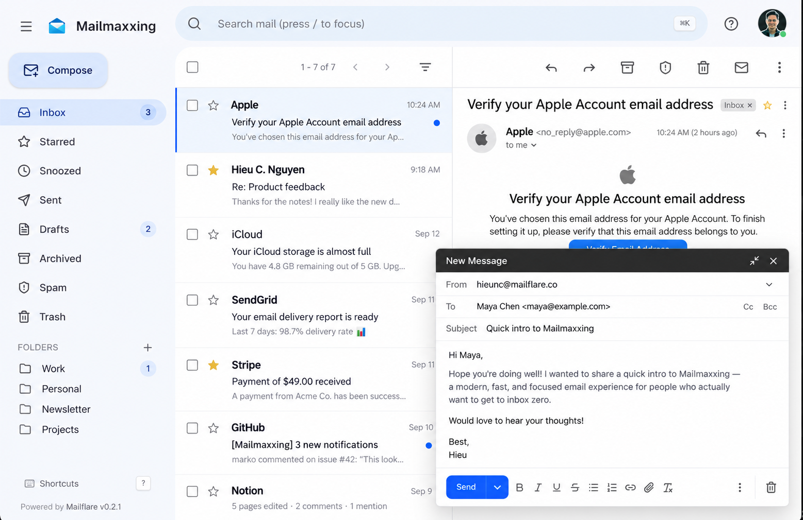
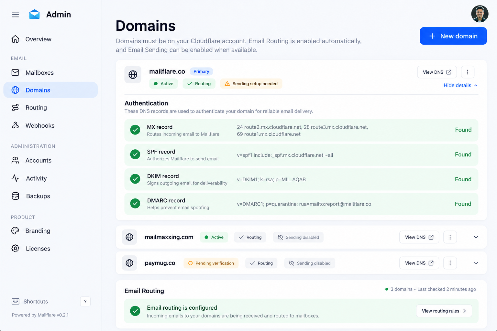
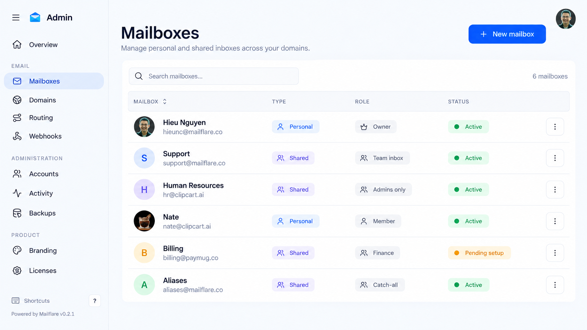

# Mail-X

<div align="center">

### Your own email platform on Cloudflare

Self-hosted email management with custom branding, unlimited standard accounts, forwarding, admin tools, AI integrations, and a modern inbox.

[](LICENSE)
[](https://workers.cloudflare.com/)
[](https://www.typescriptlang.org/)
[](https://react.dev/)

[Deploy to Cloudflare](https://deploy.workers.cloudflare.com/?url=https://github.com/kamrullab/Mail-X) · [Report an issue](https://github.com/kamrullab/Mail-X/issues) · [Source code](https://github.com/kamrullab/Mail-X)

</div>

> Mail-X is an independent, customized fork of Mailflare for people who want to run a branded email application on infrastructure they control.

## Screenshots

| Inbox | Compose | Administration |
| --- | --- | --- |
|  |  |  |

## Features

- Custom application name, icon, logo, colors, and domain.
- Unlimited standard user accounts inside Mail-X.
- Incoming mail through Cloudflare Email Routing.
- Outgoing email through Cloudflare, Resend, Amazon SES, or SMTP-compatible providers.
- Aliases and forwarding rules for users and addresses.
- Admin controls for accounts, domains, routing, and application settings.
- Modern inbox with search, labels, drafts, attachments, and notifications.
- Optional AI providers and MCP integrations.
- Global Cloudflare Workers deployment with D1 and R2 storage.

### What “unlimited” means

Mail-X does not impose a standard-account seat limit. Infrastructure and email providers can still enforce quotas, rate limits, abuse controls, storage limits, or paid usage. It means no artificial Mail-X seat cap—not unlimited Cloudflare resources or unlimited email delivery.

The visible license/subscription UI has been removed. Some specialized upstream features, including shared-mailbox access or multi-host booking, may still contain original entitlement checks internally. Test those paths before offering them as unrestricted features.

## Architecture

```text
Internet email
      │
      ▼
Cloudflare Email Routing
      │
      ▼
Mail-X Worker ─────── D1 database
      │               users, messages, settings
      ├────────────── R2 bucket
      │               raw mail and attachments
      ├────────────── Queues
      │               inbound, outbound, agents
      └────────────── Durable Object
                      realtime updates
```

## Is it completely free?

Mail-X can be used, modified, and self-hosted under AGPL-3.0. A small installation may fit within free tiers, but production is not guaranteed to cost zero.

Possible costs include a domain, Cloudflare usage above free allowances, outbound email, AI APIs, storage, logs, backups, and support. Check current provider terms:

- [Cloudflare Workers pricing](https://developers.cloudflare.com/workers/platform/pricing/)
- [Cloudflare D1 pricing](https://developers.cloudflare.com/d1/platform/pricing/)
- [Cloudflare R2 pricing](https://developers.cloudflare.com/r2/pricing/)
- [Cloudflare Email Routing](https://developers.cloudflare.com/email-routing/)
- [Resend pricing](https://resend.com/pricing)
- [Amazon SES pricing](https://aws.amazon.com/ses/pricing/)

## Deploy to Cloudflare

### Requirements

- Cloudflare account.
- A domain using Cloudflare nameservers.
- Node.js and npm.
- GitHub account for optional automated deployments.
- An outbound email provider for reliable sending.

### 1. Clone and install

```bash
git clone https://github.com/kamrullab/Mail-X.git
cd Mail-X
npm ci
```

### 2. Authenticate Wrangler

```bash
npx wrangler login
```

For CI/CD, use a scoped API token rather than an account-wide Global API Key.

### 3. Create Cloudflare resources

```bash
npx wrangler d1 create mail-x
npx wrangler r2 bucket create mail-x-raw
npx wrangler queues create mail-x-inbound
npx wrangler queues create mail-x-outbound
npx wrangler queues create mail-x-agent
```

Copy the returned D1 database ID into the matching binding in `wrangler.jsonc`. Confirm the R2, Queue, and Durable Object bindings before deployment. Mail-X uses the `RealtimeHub` Durable Object for realtime updates.

### 4. Configure secrets

```bash
npx wrangler secret put CF_TOKEN
```

Add secrets for your sending and AI providers as needed. Never commit API keys, `.dev.vars`, or local environment files.

Use separate tokens when possible:

1. A deployment token for Wrangler or CI.
2. A runtime `CF_TOKEN` for Mail-X domain/email operations.

Suggested deployment-token permissions:

- Workers Scripts: Edit
- D1: Edit
- R2: Edit
- Queues: Edit
- Account Settings: Read
- Workers Routes: Edit, only for custom routes

Suggested runtime-token permissions:

- Zone: Read
- DNS: Edit
- Zone Settings: Edit
- Email Routing Addresses: Edit
- Email Routing Rules: Edit
- Email Sending: Edit, only when required

Scope every token only to the accounts and zones Mail-X needs.

### 5. Build and deploy

```bash
npm run build
npm run deploy
```

Open the Worker URL and visit `/setup` to create the first administrator and complete setup.

### 6. Connect the domain

1. Enable Cloudflare Email Routing.
2. Add the required destination and routing rules.
3. Route incoming mail to the Mail-X Worker.
4. Add your outbound provider's DNS records.
5. Publish SPF, DKIM, and DMARC records.
6. Test incoming, outgoing, and forwarded mail before inviting users.

Receiving with Email Routing does not automatically enable outgoing delivery. Configure a sending provider separately.

### One-click start

[](https://deploy.workers.cloudflare.com/?url=https://github.com/kamrullab/Mail-X)

The button cannot safely create every production secret or complete DNS records. Review resource bindings and finish `/setup` afterward.

## Outbound providers

| Provider | Best for | Notes |
| --- | --- | --- |
| Cloudflare Email Sending | Cloudflare-native setups | Availability depends on account and region. |
| Resend | Simple API integration | Verify the domain and current limits. |
| Amazon SES | Higher-volume, cost-focused sending | New accounts may start in a sandbox. |
| SMTP provider | Existing mail infrastructure | Confirm TLS, authentication, ports, and limits. |

The provider—not Mail-X—controls outbound quotas, reputation requirements, suppression policies, and delivery limits.

## Local development

```bash
git clone https://github.com/kamrullab/Mail-X.git
cd Mail-X
npm ci
npm run dev
```

Common commands:

```bash
npm run dev
npm run build
npm run deploy
npm run lint
npm run typecheck
npm test
```

Run `npm run` to see the scripts available in your checkout.

## Configuration and secrets

| Setting | Purpose | Secret? |
| --- | --- | --- |
| `CF_TOKEN` | Runtime Cloudflare API operations | Yes |
| D1 binding | Users, messages, settings, metadata | No |
| R2 binding | Raw messages and attachments | No |
| Queue bindings | Background email and agent jobs | No |
| Sender API key | Outbound provider authentication | Yes |
| AI provider key | Optional AI features | Yes |
| VAPID keys | Optional Web Push | Private key is secret |

Use `wrangler secret put` for production and `.dev.vars` for local-only development. Keep `.dev.vars` out of Git.

## Docker and other hosting

If your checkout contains Docker configuration:

```bash
docker build -t mail-x .
docker run --rm -p 8787:8787 mail-x
```

Mail-X is built around Cloudflare services. Moving to a conventional VPS requires replacing or emulating Workers, D1, R2, Queues, Durable Objects, and Email Routing; it is not only a container deployment.

## Branding and customization

You can customize:

- Application name and page title.
- Logo, favicon, PWA icons, and social preview.
- Primary colors and theme tokens.
- Login/setup text, support links, and domain.
- Transactional email templates.

Search the full source tree before changing branding so UI labels, metadata, manifests, emails, and documentation remain consistent. Preserve all required copyright and license notices.

## Backups and upgrades

Before production updates:

1. Back up the D1 database.
2. Preserve important R2 objects.
3. Record bindings, routes, variables, and secret names.
4. Read migration notes.
5. Test in a staging Worker.
6. Verify login, inbound/outbound mail, forwarding, and attachments.

Do not overwrite production `wrangler.jsonc` without reconciling resource IDs and bindings.

## Security checklist

- Use least-privilege Cloudflare tokens.
- Separate deployment and runtime credentials.
- Protect administrator accounts strongly.
- Restrict admin access where practical.
- Validate forwarding destinations.
- Configure SPF, DKIM, and DMARC.
- Monitor queues, bounces, abuse reports, and Worker errors.
- Back up D1 and important R2 data.
- Rotate exposed secrets immediately.
- Keep dependencies updated.

## Troubleshooting

### Incoming mail does not arrive

- Confirm Email Routing and MX records.
- Check routing rules and Worker bindings.
- Inspect Worker and inbound Queue logs.

### Sending fails

- Verify provider credentials and domain status.
- Check quotas and outbound Queue retries.
- Inspect SPF, DKIM, and DMARC records.

### Deployment fails

- Run `npx wrangler whoami`.
- Check API-token permissions.
- Confirm D1, R2, and Queue resources exist.
- Verify binding names and the D1 database ID.
- Build locally before deploying.

### Realtime updates fail

- Confirm the `RealtimeHub` Durable Object binding and migrations.
- Inspect Worker logs and browser console errors.
- Verify WebSocket behavior on the custom domain.

## License and responsibilities

Mail-X is distributed under the [GNU Affero General Public License v3.0](LICENSE).

- You may use, study, modify, and redistribute it.
- AGPL conditions apply when distributing modified versions.
- When users interact with your modified version over a network, you generally must offer them its corresponding source code.
- Required copyright and license notices must remain.
- Changing the name, logo, or UI does not remove AGPL obligations.

This README is general information, not legal advice. Consult a qualified lawyer for commercial or complex licensing questions.

## Project map

```text
Mail-X/
├── src/             application and Worker source
├── public/          static assets
├── screenshots/     README previews
├── migrations/      database migrations, when present
├── wrangler.jsonc   Cloudflare bindings and deployment config
├── package.json     scripts and dependencies
├── LICENSE          AGPL-3.0 license
└── README.md        project documentation
```

## Roadmap ideas

- Easier guided Cloudflare setup.
- More admin branding controls.
- Better backup/restore tooling.
- Usage dashboards and quota alerts.
- Additional sending providers.
- Expanded tests and diagnostics.
- Clearer separation of entitlement-dependent upstream features.

## Contributing

Issues and pull requests are welcome. Open an issue before a large change to explain the use case. Never include secrets, private email, production databases, or customer information.

## Credits

Mail-X is based on the open-source Mailflare project and includes work by its upstream contributors. This fork adds Mail-X branding and product/deployment customizations while retaining applicable notices and the AGPL license.

---

<div align="center">

Built for self-hosters, communities, and teams that want control of their email experience.

</div>